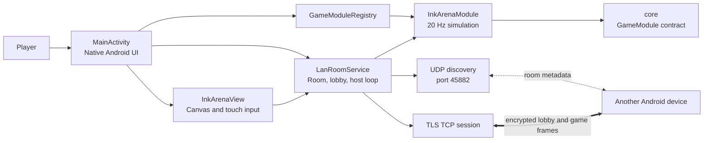
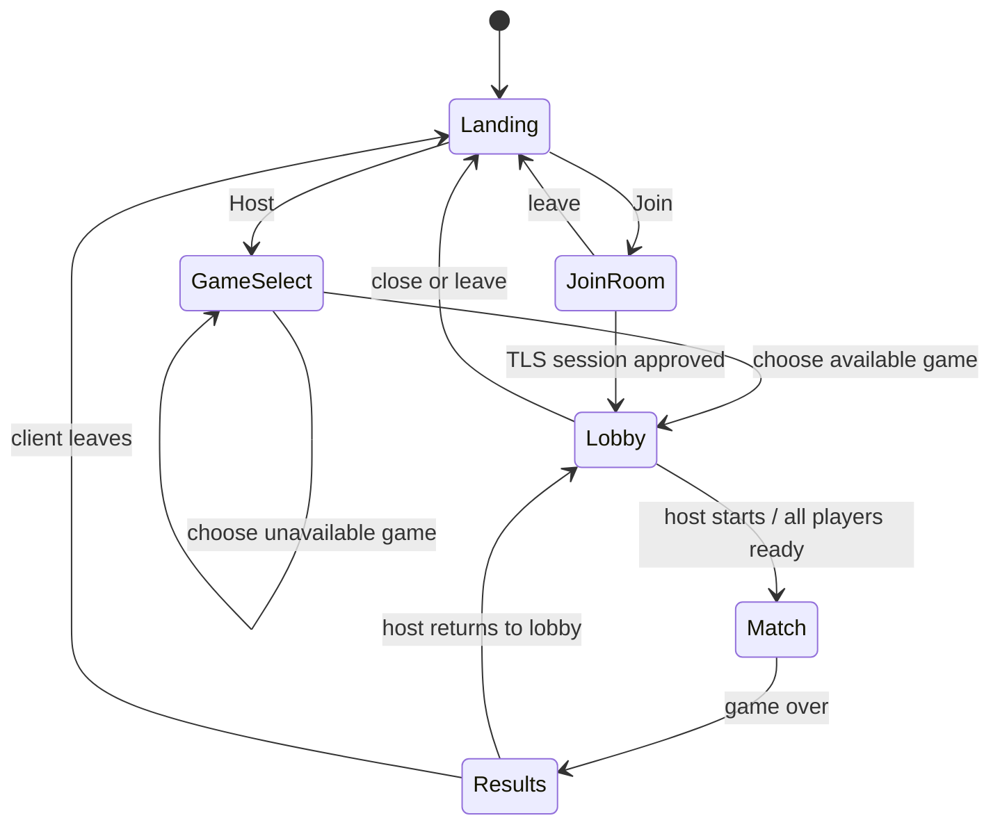

# LAN Arcade Android architecture

LAN Arcade is a native Android landscape game for players on the same Wi-Fi network. It is a Java 17, multi-module Gradle project with no Unity runtime, WebView, browser client, cloud backend, accounts, ads, or analytics SDKs.

The first release contains one complete game, **Ink Arena**, plus two registry-compatible placeholders: **Jetfire** and **3D Racer**. One phone hosts each room and is the authority for lobby state, input validation, simulation, scores, and match results.

## Design goals

- Run on Android API 24 and newer with a touch-first landscape interface.
- Let nearby players host, discover, join, and play without a remote service.
- Keep game rules independent from Android UI and network code.
- Encrypt lobby and game traffic while keeping discovery simple for an ordinary Wi-Fi network.
- Add future games through a module and one registry entry.

## Runtime structure



## Modules

| Module | Owns | Must not own |
|---|---|---|
| `app` | Activity screens, game registry, LAN transport, TLS lifecycle, lobby state, Canvas rendering, touch input. | Game-rule authority in the UI or renderer. |
| `core` | Android-independent game interfaces and value objects. | Android imports, sockets, persistence, rendering. |
| `games:ink-arena` | Board state, movement, captures, eliminations, snapshots, and results. | Android UI and socket access. |
| `games:jetfire` | Game metadata and an unavailable-module placeholder. | A playable match implementation. |
| `games:racer3d` | Game metadata and an unavailable-module placeholder. | A playable match implementation. |

`GameModuleRegistry` owns the mapping from a stable game ID to its module and availability state. The lobby and transport work from that contract, so a fourth game needs its own Gradle module and one registry entry.

```java
public interface GameModule {
    String id();
    String displayName();
    int minPlayers();
    int maxPlayers();
    void createInitialState(List<PlayerHandle> players);
    void applyInput(String playerId, byte[] input);
    void step(float deltaSeconds);
    byte[] serializeSnapshot();
    void applySnapshot(byte[] snapshot);
    boolean isMatchOver();
    MatchResult getResults();
}
```

`DeltaSnapshotModule` extends the contract for games that can serialize state relative to a previously acknowledged tick. Ink Arena implements it. Jetfire and 3D Racer are shown in game selection, then report that they are unavailable instead of starting a room.

## Screen and room lifecycle



1. The host selects Ink Arena. `LanRoomService` creates a six-character uppercase room code with `SecureRandom`, a random room ID, an ephemeral host identity, and a listening TLS server socket.
2. The host broadcasts room metadata and sees a lobby with its code, player roster, readiness, and Start Match action.
3. A joining device scans nearby advertisements or queries an entered room code, selects a compatible room, and connects using the host's advertised address, port, and certificate fingerprint.
4. The client verifies the host certificate during the TLS handshake. Both devices see a short safety string from the negotiated TLS session. The host manually approves or declines the pending player.
5. When two to six players are ready, the host creates the game state, sends a full starting snapshot, and advances Ink Arena every 50 ms.
6. When the match ends, the host sends the authoritative result. The host can return the room to the lobby; a host closing the room ends the session for all players.

## LAN discovery and encrypted transport

### Discovery

Discovery is UDP broadcast on port `45882`. It is used because devices already sharing a normal Wi-Fi subnet can find rooms without a Wi-Fi Direct group or a backend service. The host advertises:

- random room ID and game ID
- host display name
- TLS TCP listening port
- current player count and capacity
- SHA-256 fingerprint of the host's room certificate

The advertisement deliberately excludes the room code, roster, and game state. A room-code query has a bounded message format and source-IP rate limit. Discovery information is visible to nearby devices on the same network and should be considered public metadata.

### Session security

Each host room creates a short-lived P-256 key in AndroidKeyStore and a certificate used only for that room. The client creates a TLS context that pins the discovery fingerprint and accepts the connection only if the presented certificate matches. TLS 1.2 and TLS 1.3 are enabled; lobby and gameplay never use cleartext TCP.

The application shows a six-character safety code on both devices. Players compare it before the host admits the joining player. The host has no auto-accept path. The room key alias is deleted when the room closes.

### Wire protocol

TCP frames are length-prefixed and versioned:

```text
4-byte network-order length | 2-byte protocol version | 1-byte message type | payload
```

Control and input messages are capped at 4 KiB. Start and snapshot messages are capped at 64 KiB. `WireProtocol` rejects invalid lengths, unsupported versions, and unknown types before allocating or parsing a payload. Each message handler also validates field lengths, values, allowed direction, packet direction, and trailing bytes.

| Message family | Direction | Purpose |
|---|---|---|
| `ROOM_JOIN`, `ROOM_ACCEPT`, `ROOM_REJECT` | client/host | Admission request and explicit decision. |
| `LOBBY_STATE`, `READY`, `START_MATCH` | both | Synchronize roster/readiness and start a match. |
| `INPUT` | client to host | Sequenced one-byte direction intent. |
| `SNAPSHOT`, `SNAPSHOT_ACK`, `REQUEST_FULL` | host/client | Full or delta game state, acknowledgement, and recovery. |
| `MATCH_OVER`, `LEAVE`, `ROOM_CLOSED` | both | End the match or room cleanly. |
| `PING`, `PONG` | both | Detect inactive connections. |

The host rejects stale, duplicate, too-far-ahead, malformed, and out-of-range inputs before calling the game module. A connected peer is limited to 100 inbound frames per second and 60 input frames per second. Join attempts are limited to five per source IP per minute, and no more than three handshake/admission requests run concurrently.

## Ink Arena

Ink Arena is a host-authoritative 64 by 64 territory game for two to six players. The state contains compact byte arrays for cell territory and trails, plus each player's position, direction, life state, and pending direction.

At 20 Hz, the host:

1. applies each accepted direction at the next simulation step;
2. moves living players one grid cell;
3. resolves boundary, player-head, and trail-crossing collisions;
4. eliminates players whose trail is crossed, clearing their unfinished trail;
5. closes a player's trail when they return to their territory and flood-fills cells not reachable from the board edge;
6. records state for full and delta snapshots; and
7. ends the match when one player remains or five minutes elapse.

Only the host calculates movement, claims, eliminations, territory, and final scores. A client supplies intent, displays received state, and can request a full snapshot if a delta cannot be applied. The host sends a full snapshot at match start and every 60 ticks. Between full snapshots it sends changed cells against each peer's acknowledged tick, along with current player state.

`InkArenaView` renders the state using Android `Canvas` and sends debounced directional touch input to `LanRoomService`. The view does not mutate the authoritative simulation or access sockets.

## Android application and data handling

`MainActivity` is a landscape-only native Android activity. Menus and lobby screens use standard Android views; Ink Arena uses a custom `View`. The app keeps the display name in private preferences. Room codes, player lists, TLS session material, and game state remain in memory and are released when the room closes.

The manifest disables Android backup and cleartext traffic. The app requests only network and Wi-Fi state/multicast permissions required for LAN discovery and sockets. It does not request location, contacts, storage, camera, microphone, or account permissions.

## Build and release controls

- Gradle 8.7 is checked in through the wrapper; Android Gradle Plugin 8.4.2 builds against Android API 34 with JDK 21.
- `gradle/verification-metadata.xml` records SHA-256 verification data for resolved build dependencies.
- Release builds enable R8 minification and resource shrinking.
- Release signing is configured only through environment variables. The keystore and its passwords are excluded from source control.
- `network_security_config.xml` sets `cleartextTrafficPermitted="false"` for all traffic.

See `SECURITY.md` for the implementation audit, reproducible release commands, signing notes, and explicitly acknowledged residual risks.
