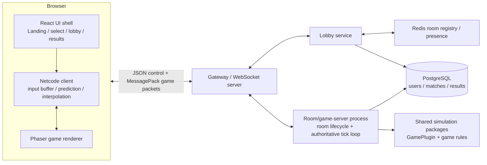
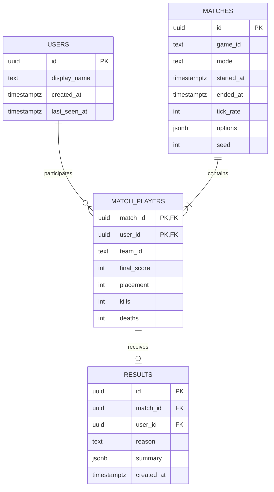
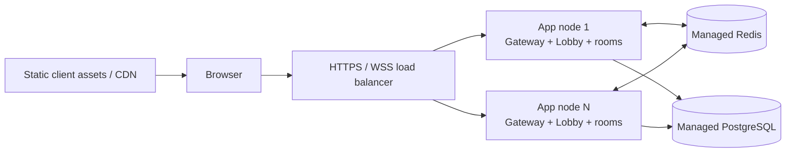

# Multiplayer Mini-Game Platform Architecture

## 1. Overview

This system is a browser-based multiplayer platform for short, real-time games. A React shell handles identity, game selection, room creation, lobby controls, and results; each game runs in an isolated canvas scene and implements a shared game plugin contract. Node.js room processes are authoritative: they validate player input and simulate the match at fixed timesteps, while clients predict their own movement and interpolate remote entities for responsive rendering. JSON control messages keep room operations easy to inspect, and compact binary game packets reduce bandwidth. The package boundaries let the platform ship Ink Arena and Jetfire together and add later games without changing room lifecycle, transport, or shell code.

## 2. Decisions and technology stack

| Concern | Choice | Reason |
|---|---|---|
| Language | TypeScript (strict) in browser and server | Shared protocol and game contracts catch drift at build time. Server-side simulation remains authoritative despite shared types. |
| Client UI | React 19, Vite, React Router | Good fit for menu and lobby UI; scenes mount as isolated canvas components rather than putting per-frame state through React. |
| Game rendering | Phaser 3, one Phaser game instance per active match | Mature 2D canvas/WebGL scenes, input, cameras, and asset loading; renderer is not the simulation authority. |
| Server runtime | Node.js 22 LTS, TypeScript, Fastify | A single process can host gateway, lobby, and rooms for MVP; Fastify provides health endpoints and operational hooks. |
| Transport | `ws` WebSocket, one socket per guest session | Low framing overhead and explicit control over packet encoding, backpressure, and message ordering. |
| Game packet codec | MessagePack via `@msgpack/msgpack`, versioned binary envelope | Compact typed payloads with less implementation burden than a bespoke binary codec. |
| UI state | Zustand for client shell; room/game state in dedicated stores | Keeps menu state simple and avoids rerendering the canvas on every packet. |
| Monorepo/build | pnpm workspaces + Turborepo + TypeScript project references | Shared packages have explicit dependencies and builds can be cached and parallelized. |
| Ephemeral persistence | Redis 7, introduced for multi-node room directory and presence | Room ownership and invites must be discoverable across gateway nodes when scaling. In single-node development, in-memory adapters are allowed. |
| Durable persistence | PostgreSQL 16 with Drizzle ORM and migrations | Stores guest identities, completed matches, participants, and results with relational constraints. |
| Hosting | Docker images on a managed container platform; managed Redis/Postgres | Stateless gateways can scale separately from room workers; room affinity is explicit. |
| Observability | Pino JSON logs, Prometheus metrics, OpenTelemetry traces | Enables per-room tick and network diagnosis without logging every game state. |

Pin exact package versions in the lockfile. The architecture assumes TLS-terminated `wss://` in production and `ws://localhost` in local development.

## 3. High-level architecture



For MVP, Gateway, Lobby, and room instances run in one Node process. The diagram shows logical boundaries, not mandatory separate deployments. At scale, gateway nodes route each room to its owning room worker using the Redis room directory.

## 4. Monorepo layout

```text
apps/
  client/                 React + Vite browser application
  server/                 Fastify, WebSocket gateway, lobby, room worker entrypoint
packages/
  protocol/               Versioned message schemas, codecs, validation
  netcode/                Client input queue, prediction, reconciliation, interpolation
  game-core/              GamePlugin contract, fixed-step loop, shared primitives
  shared/                 Cross-cutting IDs, constants, logging interfaces
  ui/                     Reusable React shell components and styling
  games/
    ink-arena/            Ink Arena simulation, scene, renderer, assets metadata
    jetfire/              Jetfire simulation, scene, renderer, weapon definitions
  persistence/            Drizzle schema, migrations, repository interfaces
  config/                 Shared lint, TypeScript, and build configuration
infra/
  docker/                 Development and production container definitions
  deploy/                 Environment-specific deployment manifests
```

| Path | Responsibility |
|---|---|
| `apps/client` | React routes and shell, session token storage, scene mounting, asset manifest. It contains no trusted game rules. |
| `apps/server` | HTTP health/readiness, WebSocket lifecycle, session validation, room allocation, tick scheduling, persistence orchestration. |
| `packages/protocol` | JSON schemas, binary packet envelope, protocol versioning, runtime input validation and generated types. |
| `packages/netcode` | Client-side input sequence tracking, local prediction, authoritative reconciliation, and remote snapshot interpolation. |
| `packages/game-core` | Plugin interface, room-independent fixed-step helpers, player and result primitives. |
| `packages/shared` | IDs, time units, error codes, and dependency-free constants shared across packages. |
| `packages/ui` | Reusable non-game React controls: buttons, forms, lobby player rows, notices. |
| `packages/games/ink-arena` | Ink Arena state model, deterministic rules, presentation scene and assets. Simulation code is importable by server and client. |
| `packages/games/jetfire` | Jetfire state model, deterministic rules, presentation scene and assets. Simulation code is importable by server and client. |
| `packages/persistence` | Postgres schema/migrations and repositories; game packages do not query the database. |
| `infra` | Container, local dependency, and deployment configuration. |

## 5. Game plugin contract

Every game package exports one plugin registration. Simulations receive seeded randomness through state or an injected deterministic RNG; wall-clock time and browser APIs are forbidden inside simulation functions. Inputs are validated and normalized before `handleInput` runs. `applySnapshot` belongs to the client adapter because it transforms wire data into a renderable local state; server snapshots use `serializeState`.

```ts
export type PlayerId = string;
export type GameResult = {
  placements: Array<{ playerId: PlayerId; place: number; score: number; teamId?: string }>;
  reason: "last_alive" | "time_limit" | "score_limit" | "host_ended";
};

export interface GamePlugin<State, Input, Snapshot, Options = unknown> {
  readonly id: string;
  readonly displayName: string;
  readonly minPlayers: number;
  readonly maxPlayers: number;
  readonly tickRate: number;
  createInitialState(players: ReadonlyArray<{ id: PlayerId; teamId?: string }>, options: Options, seed: number): State;
  handleInput(state: State, playerId: PlayerId, input: Input, dtSeconds: number): void;
  step(state: State, dtSeconds: number): void;
  serializeState(state: State, baseline?: Snapshot): Snapshot;
  applySnapshot(previous: Snapshot | null, snapshot: Snapshot): Snapshot;
  isMatchOver(state: State): boolean;
  getResults(state: State): GameResult;
}
```

The lobby reads `id`, player bounds, and display metadata to validate room creation and show selection. A room worker resolves the registered plugin by ID, constructs state after the host starts, then calls `handleInput` and `step` on fixed ticks. The client resolves the same ID to mount its renderer and snapshot adapter. Adding a game means implementing this interface, supplying its protocol schemas and scene, then adding one entry to the server and client plugin registries. Room lifecycle and lobby code remain unchanged.

## 6. Lobby and room lifecycle

### End-to-end flow

```mermaid
sequenceDiagram
  actor H as Host browser
  participant G as Gateway
  participant L as Lobby service
  participant R as Room instance
  actor J as Joiner browser
  H->>G: session.connect(token)
  H->>L: room.create(gameId, options)
  L->>L: validate plugin and host capacity
  L-->>H: room.created(roomId, roomCode)
  H->>R: room.attach(host)
  J->>G: session.connect(token)
  J->>L: room.join(roomCode)
  L->>R: room.attach(joiner)
  R-->>H: room.playerJoined(player)
  R-->>J: room.snapshot(players, settings)
  H->>R: room.ready(true)
  J->>R: room.ready(true)
  H->>R: room.start()
  R->>R: verify host, ready state, min players; create game state
  R-->>H: room.started(matchId, tick, snapshot)
  R-->>J: room.started(matchId, tick, snapshot)
  R->>R: authoritative game ticks
  R-->>H: game.matchOver(results)
  R-->>J: game.matchOver(results)
  R->>L: persist results; transition to RESULTS
  H->>R: room.returnToLobby()
  R-->>H: room.snapshot(state=WAITING)
  R-->>J: room.snapshot(state=WAITING)
```

### Room state machine

```mermaid
stateDiagram-v2
  [*] --> CREATED
  CREATED --> WAITING: room code allocated
  WAITING --> STARTING: host starts; preconditions pass
  STARTING --> IN_PROGRESS: game state initialized
  STARTING --> WAITING: spawn/init failure
  IN_PROGRESS --> RESULTS: plugin reports match over
  RESULTS --> WAITING: host returns to lobby
  WAITING --> CLOSED: host closes / idle timeout
  RESULTS --> CLOSED: close / retention timeout
  CREATED --> CLOSED: allocation failure
  CLOSED --> [*]
```



Room invariants: only the host can start, change game options, or close; player count must satisfy plugin bounds; start requires all connected players marked ready; a disconnected player has a 15-second reconnect grace period during a match. Empty waiting rooms close after 3 minutes, and results rooms close after 2 minutes unless returned to lobby. A match cannot be started while already `STARTING`, `IN_PROGRESS`, or `RESULTS`.

## 7. Networking protocol

All packets carry a protocol version and request correlation where applicable. JSON is used for infrequent control and lobby operations because it is inspectable and schema-validated. Game input and state packets use MessagePack in a binary WebSocket frame; snapshots include a baseline tick and may omit unchanged fields. A binary `kind` discriminator separates packet families.

### Envelope

```ts
type JsonEnvelope<T> = { v: 1; channel: "lobby" | "room"; type: string; requestId?: string; payload: T };
type BinaryGameEnvelope = {
  v: 1; channel: 2; // 2 = game; control channels are JSON strings
  type: 1 | 2 | 3 | 4; // input, snapshot, delta, ping
  roomId: string; tick: number; baselineTick?: number; payload: unknown;
};
```

### Lobby messages (JSON)

| Name | Direction | Payload shape | Purpose |
|---|---|---|---|
| `session.connect` | C→S | `{ token?: string }` | Resume guest identity or issue a guest session. |
| `room.create` | C→S | `{ gameId: string, options?: object }` | Request host room. |
| `room.created` | S→C | `{ roomId: string, roomCode: string, hostPlayerId: string }` | Return allocated room and share code. |
| `room.join` | C→S | `{ roomCode: string }` | Join an existing waiting room. |
| `room.joined` | S→C | `{ roomId: string, playerId: string, role: "host"|"player" }` | Confirm membership. |
| `room.error` | S→C | `{ requestId?: string, code: string, message: string }` | Report invalid code, full room, or state conflict. |
| `room.leave` | C→S | `{ roomId: string }` | Leave room cleanly. |
| `session.resume` | C→S | `{ token: string, roomId: string }` | Reattach after transient disconnect. |

### Room messages (JSON)

| Name | Direction | Payload shape | Purpose |
|---|---|---|---|
| `room.snapshot` | S→C | `{ roomId, gameId, state, hostPlayerId, players: [{id,name,connected,ready,teamId?}], options, revision }` | Initial and resynchronized lobby state. |
| `room.playerJoined` | S→C | `{ player: {id,name,connected,ready,teamId?} }` | Notify members. |
| `room.playerLeft` | S→C | `{ playerId: string, reason: "left"|"timeout" }` | Notify members and update roster. |
| `room.ready` | C→S | `{ ready: boolean }` | Set own ready flag (idempotent). |
| `room.readyChanged` | S→C | `{ playerId: string, ready: boolean }` | Broadcast ready update. |
| `room.start` | C→S | `{}` | Host requests match start. |
| `room.started` | S→C | `{ matchId: string, tickRate: number, startTick: number, seed: number, snapshot: binary }` | Transition clients into match. |
| `room.returnToLobby` | C→S | `{}` | Host returns results room to waiting. |
| `room.closed` | S→C | `{ reason: string }` | Tell clients the room has ended. |

### Game messages (binary MessagePack unless specified)

| Name | Direction | Payload shape | Purpose |
|---|---|---|---|
| `game.input` | C→S | `{ seq, clientTick, buttons, aimX?, aimY?, actions? }` | Input frame; clients send newest frame plus up to the last 3 unacknowledged frames. |
| `game.snapshot` | S→C | `{ serverTick, ackInputSeq, state, events? }` | Full state or initial/resync snapshot. |
| `game.delta` | S→C | `{ serverTick, baselineTick, ackInputSeq, changedEntities, removedIds, events? }` | Delta against acknowledged baseline. |
| `net.ping` | C→S | JSON `{ nonce, sentAtMs }` | Measure RTT and keep connection activity visible. |
| `net.pong` | S→C | JSON `{ nonce, serverAtMs }` | Respond to ping. |
| `game.matchOver` | S→C | `{ results, finalTick }` | Authoritative result and final score. |

Unknown protocol versions or malformed payloads receive a protocol error and are not passed into game code. The server caps a WebSocket frame at 32 KiB; oversized clients are disconnected. Lobby JSON messages are capped at 8 KiB.

## 8. Netcode model

Room workers run a fixed-step accumulator and never use variable `dt` for simulation. Ink Arena ticks at 20 Hz (`dt=50 ms`); Jetfire ticks at 30 Hz (`dt≈33.33 ms`). Rendering runs at display refresh rate and interpolates between server states. The client targets a 100 ms remote interpolation delay and retains at least 250 ms of snapshots.

| Technique | Behavior |
|---|---|
| Authority | Server owns positions, collisions, territory, health, ammo, cooldowns, kills, and match outcome. Client messages express intent, not resulting state. |
| Input buffering | Client assigns monotonic `seq` and tick estimates; sends at 30 Hz (Ink) or 60 Hz (Jetfire), coalescing continuous controls and preserving discrete fire/jump edges. Server accepts at most 60 input packets/sec/client and retains a bounded 250 ms queue. |
| Prediction | Client runs deterministic movement for its own avatar immediately using the same movement constants. It does not locally commit territory, kills, damage, pickups, or match results. |
| Reconciliation | Each snapshot acknowledges the last processed input sequence. Client restores the authoritative local state and replays newer buffered inputs. Large corrections are eased over 80 ms for visual continuity while collision uses corrected state. |
| Interpolation | Remote positions render between adjacent snapshots at server time minus 100 ms. If no future snapshot arrives, extrapolation is capped at 100 ms, then entities hold position. |
| Delta compression | Server emits a delta against a client-acknowledged baseline, with a full snapshot every 2 seconds and on resync. Never delta against an unacknowledged packet. |
| Lag compensation | Jetfire stores 250 ms of timestamped hitbox history. A fire input is clamped to the measured RTT-derived rewind window (maximum 150 ms), then server raycasts against historical player hitboxes while projectile travel and damage remain server-owned. Ink Arena uses no rewind: grid claims and trail crossings resolve at authoritative ticks. |

Ink Arena clients predict heading and grid-step motion; territory/capture is rendered only after server confirmation. Jetfire clients predict movement, facing, jetpack thrust, and local weapon muzzle animation; damage, hit registration, projectile collision, ammo consumption, and scoring are server-simulated. Client prediction shares pure movement functions but is treated as presentation and never trusted.

## 9. Game-specific architecture

### Ink Arena

The arena uses a fixed 128×128 logical grid (16,384 cells) with 4–16 players. Store owner IDs in a dense `Uint8Array` (`0` neutral, player slots `1..16`) and trails in a second dense `Uint8Array`; this gives predictable memory access and makes full territory snapshots only 16 KiB before compression. Player metadata maps slots to stable player IDs. Serialize changed row runs for deltas; send a compressed full grid at match start, every 2 seconds, and after reconnect.

At each tick, validate each player's direction change, advance by one grid cell at configured movement cadence, and detect head/trail overlap. If a player enters an enemy trail, eliminate that trail owner; if an enemy enters the current player's trail, eliminate the current player. Returning to an owned cell closes the loop. Flood-fill neutral cells from the map boundary while treating the player's trail as a barrier; cells not reachable from outside are captured. Resolve simultaneous closures in stable player-slot order. Captured cells become territory and trail cells are cleared. Last living player wins; if a configured time limit expires, highest territory count wins, then survival time.

```ts
type InkArenaState = {
  tick: number;
  gridWidth: 128;
  gridHeight: 128;
  owners: Uint8Array;       // 16,384 owner slots
  trails: Uint8Array;       // 0 or owning player slot
  players: Record<string, { slot: number; x: number; y: number; direction: 0|1|2|3; alive: boolean; territory: number; trailLength: number }>;
  rngSeed: number;
};
```

### Jetfire

Jetfire is a side-view arena with 2–8 players and a 30 Hz authoritative simulation. Use fixed-point integer positions at 1/256 world-unit precision, semi-implicit Euler integration, gravity, horizontal acceleration, and a capped terminal velocity. Jetpack thrust consumes fuel while held and regenerates after release; initial tuning is 100 fuel, 35 units/sec consumption, 22 units/sec regeneration, and 0.65× gravity while thrusting. Platforms are static axis-aligned rectangles; movement uses swept AABB collision to avoid tunneling. Weapons, projectiles, cooldowns, ammo, hitboxes, and damage are server-owned.

| Weapon | Mode | Damage | Rate | Projectile speed | Magazine / reserve |
|---|---|---:|---:|---:|---:|
| Sidearm | hitscan | 18 | 3 shots/sec | — | 12 / 48 |
| Rifle | hitscan | 12 | 8 shots/sec | — | 30 / 120 |
| Rocket | projectile, splash radius 2.5 | 60 direct, 35 splash | 0.8 shots/sec | 18 units/sec | 4 / 12 |

Represent weapon definitions as immutable data rows keyed by `weaponId`; match state holds the selected ID and per-player ammo/cooldown. Hitscan raycasts are evaluated by the server with bounded rewind history. Rockets are server-simulated entities and explode on collision or after 3 seconds. Map data is versioned JSON: world dimensions, spawn points, platform rectangles, weapon pickup points, and bounds. FFA scores kills; team deathmatch requires team assignment and ends at 25 kills or 8 minutes. The initial release supports both modes, with friendly fire disabled.

```ts
type JetfireState = {
  tick: number;
  mode: "ffa" | "tdm";
  players: Record<string, { x: number; y: number; vx: number; vy: number; facing: -1|1; grounded: boolean; fuel: number; health: number; alive: boolean; teamId?: string; weaponId: string; ammo: Record<string, { magazine: number; reserve: number }> }>;
  projectiles: Array<{ id: number; ownerId: string; x: number; y: number; vx: number; vy: number; damage: number; splashRadius: number; expiresTick: number }>;
  kills: Record<string, number>;
  mapId: string;
};
```

## 10. Client architecture

React routes through `Landing → GameSelect → Lobby → Match → Results`; route guards derive their state from the session and room snapshot. The shell owns forms, focus, accessibility, network status, player roster, ready controls, and host actions. A `MatchHost` component mounts a Phaser scene for the registered game plugin and passes it a `GameClientAdapter` with input submission, latest snapshots, confirmed events, and clock estimate.

The netcode adapter is independent of Phaser. Game scenes consume state and emit normalized input intents; renderers cannot call room APIs or write authoritative state. Asset manifests are loaded on scene entry with progress and failure handling; gameplay-critical hitboxes and map dimensions come from versioned game data rather than image dimensions. React updates at UI event frequency, while Phaser renders on its own frame loop. On match end the scene freezes at the final confirmed state and the shell displays results.

## 11. Server architecture

### Connection and room ownership

1. Browser requests or resumes a signed guest token; the server assigns a stable guest user ID and short-lived connection ID.
2. WebSocket upgrade validates origin, token, protocol version, and connection limits. Heartbeats run every 10 seconds; a connection is stale after 30 seconds without pong.
3. Lobby operations validate membership and room state before dispatching to the owning room instance.
4. A room owns its member roster, plugin instance, input queues, snapshot baselines, tick timer, and result transition. It runs one fixed-step loop and batches outbound state once per tick.
5. On disconnect, the player becomes disconnected and may resume within 15 seconds using their guest token. After grace expiry, they are removed; during a match the game plugin applies its documented disconnect policy (both games mark the player eliminated).

MVP runs gateway, lobby, and all room instances in one Node process, with a hard limit of 100 concurrent rooms per process. CPU-heavy game simulation stays synchronous and bounded; database writes and compression run outside the tick-critical section. When CPU utilization exceeds 70% for 5 minutes or room count exceeds the limit, deploy dedicated room workers. Redis stores `roomCode → {roomId, ownerNodeId, gameId, state, expiresAt}` and `roomId → ownerNodeId`; gateways route to the owner. Use sticky WebSocket routing for a connection and room affinity for ownership. A node lease and heartbeat make crashed owners detectable; rooms on a lost node close and clients receive a reconnect error (match recovery/replay is a later feature).

### Backpressure and limits

Each connection has a bounded outbound queue of 256 KiB. Drop superseded game deltas when a client is slow, then send a full snapshot when it catches up; never drop room/control messages silently. Disconnect if queue remains over limit for 5 seconds. Limit create/join attempts to 10/minute per IP, chat is out of scope for v1, and game input to 60 frames/sec with a token bucket burst of 20. Room operations are idempotent by `requestId` for 30 seconds.

## 12. Data model and persistence



`users` represents anonymous guest identities; a later account system can attach credentials without changing match foreign keys. `matches` and participant rows are committed when a match starts/ends in a transaction; result summaries are written on completion. Redis contains only ephemeral room code mappings, live roster/ready state for cross-node discovery, node leases, and expiring reconnect metadata. Postgres contains durable users and match records. Do not store per-tick snapshots in Postgres in v1.

## 13. Security and anti-cheat

- The server is authoritative for all score-affecting decisions. Never accept client positions, health, territory, kills, ammo, or match completion.
- Validate every decoded message with protocol schemas, enforce enum/range limits, reject NaN/infinite values, and bind player IDs to the authenticated socket rather than payload identity.
- Clamp movement intent to legal values; enforce per-game acceleration, speed, cooldown, fuel, bounds, and input sequence checks. Detect impossible displacement and discard the offending input; repeated violations disconnect and increment an abuse counter.
- Guest tokens are signed, short-lived access credentials with rotating refresh tokens stored as secure, HttpOnly cookies where same-site deployment permits. Never put database credentials or signing keys in the client bundle.
- Generate room codes from a cryptographically secure alphabet with at least 40 bits of entropy (8 chars from a 32-character alphabet); normalize case, expire closed codes, and rate-limit guesses.
- Apply origin allowlists, TLS, payload limits, per-IP and per-session rate limits, connection caps, and structured abuse logging. Avoid logging tokens or full input streams.
- Jetfire lag compensation is server-bounded and uses observed RTT, so clients cannot request arbitrary rewind. Ink Arena territory and trail collision are computed only by the server.

## 14. Scalability and performance targets

| Metric | Target |
|---|---:|
| Ink Arena room capacity | 16 players |
| Jetfire room capacity | 8 players |
| Ink Arena authoritative rate | 20 Hz |
| Jetfire authoritative rate | 30 Hz |
| p95 room tick duration | < 10 ms Ink; < 12 ms Jetfire on a 2 vCPU worker |
| Typical game delta | < 2 KiB Ink; < 1 KiB Jetfire |
| Full snapshot | < 24 KiB compressed Ink; < 8 KiB Jetfire |
| Server egress per player | < 20 KiB/s Ink; < 15 KiB/s Jetfire at target rates |
| Input-to-local-render | p95 < 50 ms on a 60 Hz client, excluding device/network latency |
| Input-to-confirmed-render | p95 < 150 ms at RTT ≤ 80 ms |
| Rooms per MVP process | 100, validated by load test; scale threshold at 70% sustained CPU |

Scale from one combined node to N nodes by separating gateways from room workers, placing room ownership in Redis, and routing by room affinity. Add Postgres connection pooling and partition match history only after measured volume requires it. Stateless web assets can be served from a CDN. Do not split lobby into its own service until gateway CPU or deployment cadence justifies the additional network boundary.

## 15. Observability and testing

Emit Pino JSON logs with `connectionId`, `roomId`, `matchId`, `gameId`, and `nodeId`; redact tokens and avoid logging each input. Prometheus metrics include active sockets/rooms, room population, tick duration histogram, tick overruns, snapshot bytes by game, queued outbound bytes, RTT, input rate, reconnects, validation failures, and match duration. Trace room create/join/start and match persistence, not every simulation tick.

Game-rule unit tests use deterministic seeds and fixed input scripts for movement, capture, collisions, weapon cooldowns, and match results. Protocol integration tests run real WebSocket clients against an in-process server and verify invalid messages, room transitions, reconnect, and snapshot ordering. A headless bot harness launches 100 rooms with game-specific bots, ramps to 1,000 concurrent clients, and records tick p95/p99, packet sizes, CPU, memory, and disconnects. CI runs typecheck, lint, unit tests, protocol integration tests, and production builds; load tests run on release candidates rather than every commit.

## 16. Deployment and local development

### Container topology



For the first release, run one app container plus Redis and Postgres. Production WebSocket load balancing must support connection upgrades and preserve a connection to its gateway; room ownership routing is application-level.

### Environment variables

| Variable | Required | Example / purpose |
|---|---|---|
| `NODE_ENV` | yes | `development`, `test`, or `production` |
| `PORT` | yes | HTTP/WebSocket listener, default `3000` |
| `PUBLIC_ORIGIN` | yes | `http://localhost:5173`; allowed browser origin |
| `DATABASE_URL` | yes | Postgres connection string |
| `REDIS_URL` | production | Redis connection string; omitted for in-memory single-process dev adapter |
| `SESSION_SIGNING_KEY` | yes | Random 32-byte-or-longer secret; rotate through deployment secret manager |
| `ROOM_CODE_TTL_SECONDS` | no | Default `10800` |
| `MAX_ROOMS_PER_NODE` | no | Default `100` |
| `LOG_LEVEL` | no | Default `info` |
| `OTEL_EXPORTER_OTLP_ENDPOINT` | no | OpenTelemetry collector endpoint |
| `VITE_SERVER_URL` | client build | `ws://localhost:3000`; production `wss://play.example.com` |

CI runs install from the frozen pnpm lockfile, typecheck, lint, rule/protocol tests, and builds. On merge to main, build immutable client and server images, run migrations as a one-off job, deploy to staging, execute smoke tests, then promote the same image digests to production with health checks and rollback on readiness failure. Database migrations are backward-compatible across one deploy overlap.

### Local development

Requirements: Node.js 22, pnpm 9, Docker. Start dependencies and both applications with one command:

```bash
pnpm dev
```

`pnpm dev` runs the local Postgres and Redis containers, applies migrations, and starts Vite plus the Node server with watched TypeScript builds. Open `http://localhost:5173`; use two browser profiles to exercise host and join flows. `pnpm dev:apps` may be provided for contributors who already run local dependencies.

## 17. Roadmap and extension points

| Capability | Extension seam |
|---|---|
| Game #3 | Add `packages/games/<id>` with plugin, schemas, scene, assets, and registry entries. Lobby and room protocol remain generic. |
| Teams | Standardize `teamId` in roster and result types; add lobby team assignment policy and plugin team rules. Jetfire already carries optional team IDs. |
| Matchmaking | Add a queue service that requests rooms through the same room allocation API; it does not alter game simulation. |
| Accounts | Link guest `users.id` to account credentials; preserve stable participant foreign keys. |
| Replays | Persist versioned input frames and initial seed, then replay deterministic simulation in an isolated worker. Add periodic checkpoints only if replay seek time requires them. |

Every game must declare protocol/schema version, simulation version, deterministic seed handling, disconnect behavior, player bounds, and bandwidth expectations before registration. This keeps future games within the same session, room, and transport model while allowing game-specific simulation and presentation.
