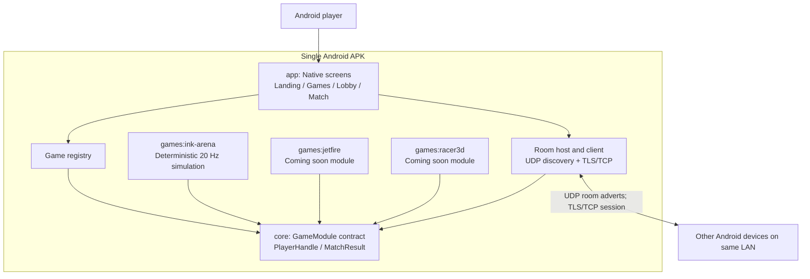

# LAN Arcade for Android — Architecture

## Overview

LAN Arcade is a native Android multiplayer game platform for phones on the same local Wi-Fi network. The Android app provides Host/Join, game selection, room discovery, lobby, and game hosting screens. One device is the authoritative host for each match; other devices send validated input and render synchronized snapshots. Ink Arena is the first playable game. Jetfire and Racer3D are registered modules with an explicit coming-soon state. The project is a Java 17, multi-module Gradle build with an Android application shell and Android-independent game simulation modules. It does not use a browser, React, Phaser, a cloud service, or a remote game server.

The v1 transport uses UDP broadcast for room discovery and TCP protected by TLS for lobby and game traffic. Discovery adverts contain no room code, player identity, or game state. The user enters a cryptographically generated room code and the host explicitly approves each new connection. The peers compare a short authentication string derived from the TLS session before gameplay. This keeps game data encrypted while allowing nearby devices to find a host without requiring a Wi-Fi Direct group or router configuration.

## Stack and platform choices

| Area | Choice | Reason |
|---|---|---|
| Platform | Android, min API 24, landscape gameplay | Native app lifecycle, touch input, local network access, and installable APK. |
| Language | Java 17 for application and pure-Java modules | Supported by Android Gradle Plugin and avoids mixing Kotlin plugin versions into the first build. |
| UI | Android framework `Activity`, `View`, and custom `Canvas` drawing | No UI framework dependency; adequate for menus, touch controls, and the 2D Ink Arena grid. |
| Build | Gradle wrapper 8.7, Android Gradle Plugin 8.4.2 | Reproducible project build; AGP is compatible with Gradle 8.7 and API 34. |
| Module structure | `app`, `core`, and three `games/*` Java libraries | Keeps Android APIs out of simulation code and makes each game independently registerable. |
| Discovery | UDP broadcast on the connected Wi-Fi subnet | Simple same-LAN discovery that works with normal access points; does not silently negotiate Wi-Fi Direct. |
| Session transport | TLS 1.3 over TCP sockets | Reliable ordered inputs/snapshots and encrypted lobby/game traffic. Host keys are generated locally and are never embedded in the APK. |
| Serialization | Versioned, length-prefixed binary messages with strict bounds | Small game packets and early rejection of malformed or oversized input without a runtime serialization dependency. |
| Durable storage | None in v1; local display name in app preferences | Matches are local and transient; no account server or credentials are required. |
| Release hardening | R8 shrinking/obfuscation, resource shrinking, Android network security config, Gradle dependency verification | Reduces release surface and makes dependency integrity an explicit build condition. |

The release target is a signed APK for ARM64 Android devices. A local development keystore may be used for repeatable sideload builds; its private key and password stay outside source control. A production/store signing key must be managed separately by the release owner.

## Module architecture



The host phone runs the room listener and is authoritative for the match. A joined phone is a client. Each game module contains deterministic rules and a renderer/controller adapter; the app owns screen transitions and session/network lifecycle. The module registry is the only game-selection seam.

### Repository layout

```text
app/                         Android app, Activity, screens, drawing, touch and networking
  src/main/AndroidManifest.xml
  src/main/java/.../         App entrypoint, screen state, room service, packet codec
  src/main/res/xml/          Network security policy
core/                        Pure Java game contract and shared value objects
games/
  ink-arena/                  First playable territory game
  jetfire/                    Registered coming-soon module
  racer3d/                    Registered coming-soon module
gradle/wrapper/               Pinned Gradle 8.7 wrapper
gradle/verification-metadata.xml  Dependency checksums required for resolution
ARCHITECTURE.md                This document
SECURITY.md                    Release self-audit and residual risks
```

| Module | Responsibility |
|---|---|
| `:app` | Android entry point, host/join screens, game cards, room code, lobby, TLS/UDP services, input/render bridge, permission and lifecycle handling. |
| `:core` | Pure Java `GameModule`, player handles, input/result types. Must not import `android.*`. |
| `:games:ink-arena` | Grid state, movement, trail rules, claims, eliminations, snapshot codec, 2D drawing support. |
| `:games:jetfire` | Contract registration, display metadata, player limits. Match creation remains disabled with a coming-soon explanation. |
| `:games:racer3d` | Contract registration, display metadata, player limits. Match creation remains disabled with a coming-soon explanation. |

## Game module contract and registration

The host app resolves a game by stable ID. Both host and clients load the same module. Only the host invokes authoritative state mutation; clients call `applySnapshot` and produce input. Every packet is validated in the app networking boundary before a game method is called.

```java
package com.langame.core;

import java.util.List;

public interface GameModule {
    String id();
    String displayName();
    int minPlayers();
    int maxPlayers();
    void createInitialState(List<PlayerHandle> players);
    void applyInput(String playerId, byte[] input);
    void step(float deltaSeconds);
    byte[] serializeSnapshot();
    void applySnapshot(byte[] snapshot);
    boolean isMatchOver();
    MatchResult getResults();
}
```

The registry is an immutable map keyed by `id()`, created once at app startup. It contains `ink_arena`, `jetfire`, and `racer3d`. Game selection reads each module's display name and player range. A module marked unavailable remains visible and selectable; selecting it shows “Not available in this build” and returns to selection without creating a room. A fourth game is a new library module and one registry entry.

## Screen and room lifecycle

```mermaid
stateDiagram-v2
  [*] --> Landing
  Landing --> GameSelect: Host
  Landing --> JoinRoom: Join
  GameSelect --> Lobby: choose Ink Arena and create room
  GameSelect --> GameSelect: choose unavailable game / show message
  JoinRoom --> Lobby: valid code and host accepts
  JoinRoom --> JoinRoom: invalid code / retry
  Lobby --> Match: host starts; minimum players connected
  Lobby --> Landing: host closes or player leaves
  Match --> Results: host simulation reports terminal state
  Results --> Lobby: host starts another round
  Results --> Landing: leave room
```



| Room state | Meaning and permitted transition |
|---|---|
| `CREATED` | Host allocated a code and begins advertising. Transitions to `WAITING`. |
| `WAITING` | Players can request to join, host approves/declines, and players appear in lobby. Host starts only when game minimum is met. |
| `STARTING` | Host locks roster, assigns stable player IDs, seeds game state, and sends a full initial snapshot. Failure returns to `WAITING`. |
| `IN_PROGRESS` | Host accepts sequenced inputs and advances the simulation at 20 Hz. |
| `RESULTS` | Terminal snapshot and results are sent; input is ignored except lobby/leave controls. |
| `CLOSED` | Listener and advertisement stop; sockets and transient match data are released. |

Host departure closes the room in v1. A disconnected player may reconnect with the session token held in memory for 15 seconds; otherwise they are removed and Ink Arena marks them eliminated. No state migration or host election is claimed.

## LAN discovery and protocol

The host broadcasts a bounded room advertisement every 2 seconds over UDP with protocol version, random room ID, game ID, host display name, listening port, player count, expiry, and the TLS certificate fingerprint. It does not broadcast the room code or game state. Clients listen only while the Join screen is open. The UI also supports entering the room code manually and connecting to a room discovered on the current subnet. Wi-Fi Direct is not used in v1.

After discovery, the client enters the six-character room code (uppercase letters and digits, generated by `SecureRandom`) and opens a TLS 1.3 TCP connection. The TLS certificate is generated for that host session using a device-held key; no private key ships in the app. The client verifies the advertised certificate fingerprint and displays a short session authentication string to both users. The host must explicitly approve the pending player, and the two users compare the authentication string before the host admits the peer. There is no auto-accept path. A forged or intercepted discovery advert can cause a failed connection or a mismatched authentication string, but cannot silently decrypt accepted game traffic.

Messages use a four-byte network-order length followed by a versioned binary frame. Maximum frame sizes are 4 KiB for input/control and 64 KiB for snapshots. The parser rejects invalid lengths, unknown message types, unsupported versions, invalid player IDs, stale/out-of-order sequence numbers, impossible values, and excess rates before simulation dispatch. Inputs are limited to 60 messages per second per peer with a burst of 20; invalid or over-limit connections are closed. Room codes are rate-limited per IP/session and expire when a room closes.

| Frame | Direction | Fields | Purpose |
|---|---|---|---|
| `ROOM_JOIN` | client → host | protocol version, room code, client nonce | Request admission; host still requires explicit approval. |
| `JOIN_CHALLENGE` | host → client | challenge nonce, room/game metadata | Establish a fresh session and show host confirmation. |
| `JOIN_ACCEPT` / `JOIN_REJECT` | host → client | assigned player ID or bounded error code | Complete or deny lobby admission. |
| `LOBBY_SNAPSHOT` | host → clients | room state, host ID, roster, readiness, revision | Initial state and reconnect resynchronization. |
| `READY` | client → host | boolean, sequence | Set the sender's ready state. |
| `START_MATCH` | host → clients | game ID, seed, start tick, full snapshot | Begin the authoritative simulation. |
| `INPUT` | client → host | player ID bound to connection, sequence, tick, one-byte direction | Submit Ink Arena input intent. |
| `SNAPSHOT` / `DELTA` | host → clients | tick, acknowledged input sequence, state/delta | Synchronize game state; full snapshot every 60 ticks. |
| `MATCH_OVER` | host → clients | final tick, placements, scores, reason | Display authoritative results. |
| `PING` / `PONG` | either direction | nonce, monotonic timestamp | Measure latency and detect dead peers. |

## Ink Arena simulation

Ink Arena is a two-dimensional grid territory game for 2–6 players in the first build. The host simulates at 20 ticks per second with a fixed `deltaSeconds` of 0.05. The initial board is 64×64 cells; each cell stores neutral/territory owner and optional trail owner in compact byte arrays. A deterministic seed controls spawn positions. Each player sends one direction byte: `0=up`, `1=right`, `2=down`, `3=left`. The host rejects reversals, invalid values, stale sequences, and movement beyond one legal step per tick.

Each tick advances living players, resolves head collisions and trail crossings in stable player-ID order, and applies closures. A player outside their owned territory leaves a trail. Returning to owned territory closes a shape; the host flood-fills unoccupied cells from the map boundary while treating the player's trail as a barrier, then claims enclosed cells. Crossing an opponent's trail eliminates the trail owner; crossing the local player's trail eliminates that player. Simultaneous conflicts resolve by player-ID order to keep results deterministic. The match ends when one player remains or the time limit expires; time-limit ties resolve by territory count, then survival tick.

Clients predict only their own visual movement. Territory, collisions, eliminations, score, and game-over state are never trusted from client input. Snapshots carry changed cell runs against the last acknowledged snapshot; the host sends a full board at match start, every 60 ticks, and on reconnect. If a delta's baseline is missing, the client requests a full snapshot.

## Android app and input/rendering

The shell uses a small screen state controller: `Landing`, `GameSelect`, `JoinRoom`, `Lobby`, `Match`, and `Results`. Menus and lobby use native views. Ink Arena uses a custom `View`/`Canvas` renderer with touch directional controls; it does not use Unity, libGDX, WebView, or a downloaded asset engine. The rendering layer consumes immutable snapshots and interpolation state. It does not write simulation state or access sockets directly. Activity recreation preserves the room/session service while a match is active; closing/losing the host closes the room cleanly.

The layout is landscape, supports cutouts/insets, and scales the board to the safe content area. Controls have large touch targets and directional input is sampled/debounced to avoid sending redundant packets. Target rendering is 60 fps; the simulation and network snapshot cadence remain 20 Hz.

## Persistence and privacy

V1 stores only an optional display name and basic UI preferences in app-private preferences. Room codes, TLS session keys, roster, and match state live in memory and are cleared on room close. No account system, analytics SDK, advertising SDK, cloud match history, or external API key is included. Android backup is disabled unless a future reviewed policy explicitly allows selected preferences to be backed up.

## Security baseline and release gates

- `network_security_config.xml` denies cleartext Android networking. Room gameplay is TLS 1.3 over TCP; UDP broadcast carries discovery metadata only.
- Host private keys are generated locally and never embedded. TLS peers verify the session certificate fingerprint; users compare an in-session authentication string; host approval is required for every join.
- Room codes use `SecureRandom`; no secret, signing password, debug bypass, or test credential is in release source.
- All network frames are size-bounded and schema-checked before game simulation. Per-peer rate limits and sequence checks are enforced at the app transport boundary.
- Release enables R8 minification and resource shrinking. Keep rules are restricted to classes that require reflection.
- Gradle dependency verification is enabled with SHA-256 metadata for all resolved build and runtime artifacts. Adding/updating a dependency requires a reviewed checksum metadata change.
- Release manifest disables backup and debugging. The signing key is not committed.

Security findings, OWASP MASVS category mapping, exact build/install commands, and residual risks belong in the release `SECURITY.md` after implementation and verification. This architecture does not claim a completed MASVS audit or a tested/signed APK before those gates pass.

## Build and validation sequence

Build with the checked-in wrapper from the repository root:

```powershell
./gradlew assembleDebug
adb install -r app/build/outputs/apk/debug/app-debug.apk
```

Before gameplay implementation, the Android prerequisites must be verified and this empty launcher APK must build and install on a connected API 24+ Android device or emulator. Then implement the shell and networking, Ink Arena simulation/rendering, and game stubs in that order. Verify two-device LAN discovery, explicit admission, encrypted session setup, input limits, full/delta snapshot recovery, and a complete match. Only then create the release signing configuration, run `assembleRelease`, verify with `apksigner`, install the signed APK, launch it, and complete the MASVS self-audit. A build without a connected installation target is not considered a verified final APK.
